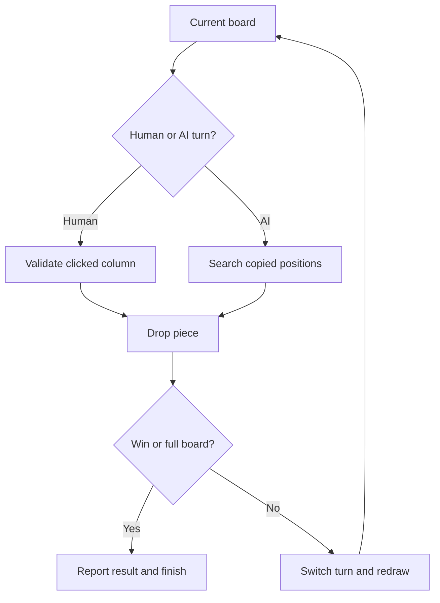

# Connect Four with a Minimax Opponent: project walkthrough

[Overview](../README.md) · [Code reference](CODE_REFERENCE.md) · [Development guide](DEVELOPMENT.md)

## Two layers in one source file

[connect_4.py](../connect_4.py) contains both a game engine and a Pygame interface. Importing the module exposes the engine without opening a window. Running the file calls `main`, which imports Pygame, creates the display, and enters the event loop. NumPy remains required by the engine.

## Repository map

| Path | Responsibility |
| --- | --- |
| [connect_4.py](../connect_4.py) | Board operations, scoring, minimax, drawing, and the game loop |
| [requirements.txt](../requirements.txt) | NumPy and Pygame environment requirements |
| [tests/test_game.py](../tests/test_game.py) | Rules, search decisions, terminal states, and invalid-input checks |

## Board and turn representation

The board has six rows and seven columns. Empty cells are `0`, the human's pieces are `1`, and the computer's are `2`. Row zero is the bottom row in the engine: `get_next_open_row` searches upward from zero, and `draw_board` converts those logical coordinates into screen coordinates. Player/AI turn constants are separate from the piece values.

`drop_piece` mutates the supplied board. Search instead creates a copy for every hypothetical move, so considering a move does not change the real position. `winning_move` checks horizontal, vertical, positive-diagonal, and negative-diagonal alignments.

## How the computer chooses a move

`evaluate_window` scores a group of four cells: completed alignments and promising partial alignments receive positive scores, while an opponent's three-piece threat receives a penalty. `score_position` applies that rule to every relevant window and adds a preference for the center column.

`minmax(board, depth, maximizingPlayer, alpha, beta)` alternates maximizing the AI score and minimizing it on behalf of the opponent. A terminal win/loss has priority over the positional heuristic. Full boards return no move and a draw score. At depth zero, the heuristic is used. Valid columns are examined from the center outward, and alpha-beta bounds stop branches that cannot improve the result. The UI uses depth three; no claim is made that this is an unbeatable strategy.

`pick_best_move` is an alternative one-move heuristic helper. It is defined for experimentation but the UI's AI turn calls `minmax`.

## Turn flow

## Follow a tactical example

If the AI has three adjacent pieces in the bottom row and the fourth column is open, searching that column finds an immediate win. If the human has the same threat, the AI needs sufficient depth to see and block the next human move. The tests construct both cases and also verify that the board passed to search is unchanged afterward.

The initial turn is chosen randomly. The interface caps its loop at 60 frames per second, handles window-close events, and ends when a win or draw is detected. See the [code reference](CODE_REFERENCE.md) for every defined helper and the [development guide](DEVELOPMENT.md) for the environment.
